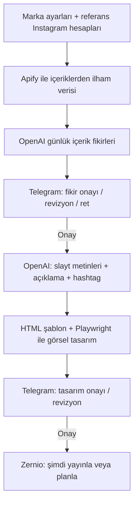

<div align="center">

# Instagram İçerik Motoru

**Fikirden tasarıma, onaydan planlı paylaşıma — Telegram üzerinden yönetilen içerik üretim hattı.**

[Kurulum Rehberi](BENI-OKU.md) · [Yapılandırma](config.yaml) · [Sorun Bildir](https://github.com/selcukcan74/ig-icerik-botu/issues)

</div>

---

## Ne yapar?

Instagram içerik üretimini tek bir akışta toplar. Marka bilgileri ve referans hesaplardan yararlanarak günlük fikirler üretir; her kritik aşamada Telegram üzerinden insan onayı ister. Onaylanan içeriği görsele dönüştürür ve Zernio üzerinden yayınlar veya ileri bir tarihe planlar.

## İş akışı



## Özellikler

- Referans Instagram hesaplarından içerik ve etkileşim sinyalleri toplama (Apify).
- OpenAI ile özgün fikir, carousel/slayt metni, açıklama ve hashtag üretimi.
- Telegram üzerinden fikir ve son tasarım için ayrı onay kapıları.
- Telegram mesajına yanıt vererek içerik revizyonu.
- HTML/Jinja şablonları ve Playwright ile görsel çıktısı.
- Zernio ile Instagram gönderisini hemen yayınlama veya ileri tarihe planlama.
- Günlük yayın slotları ve kuyruk sınırı.
- `/tasarla` ile belirli bir müşteri/marka brief'i üzerinden içerik hazırlama.

## Teknoloji

Python · OpenAI API · Apify · Telegram Bot API · Playwright · Jinja2 · SQLite · Zernio

## Hızlı başlangıç

> İlk kurulum ve her müşteride değiştirilmesi gereken alanlar için önce **[BENI-OKU.md](BENI-OKU.md)** dosyasını okuyun.

```bash
git clone https://github.com/selcukcan74/ig-icerik-botu.git
cd ig-icerik-botu
python3 -m venv .venv
source .venv/bin/activate
pip install -r requirements.txt
playwright install chromium
cp .env.example .env
# .env ve config.yaml dosyalarını kendi hesabınıza göre düzenleyin
./run.sh
```

## Güvenlik

- Gerçek API anahtarlarını, Telegram tokenını, sohbet kimliğini ve Zernio hesap bilgilerini **asla** Git'e eklemeyin.
- Gizli değerler yalnızca yerel `.env` dosyasında tutulmalıdır. `.env` Git tarafından yok sayılır.
- `data/` klasörü; SQLite veritabanı, indirilen referanslar, görseller ve loglar içerir. Dağıtım paketine dahil edilmez.
- Referans hesaplardan alınan içerikleri kopyalamayın; yalnızca konu, format ve etkileşim sinyallerinden ilham alarak özgün içerik üretin.
- Instagram, Apify, OpenAI, Telegram ve Zernio kullanım şartlarına ve ilgili hesapların izinlerine uyun.

## Proje yapısı

```text
igbot/                 Bot, içerik üretimi, veritabanı ve servis entegrasyonları
templates/             Instagram görsel şablonları
config.yaml            Marka, tasarım, yayın ve ilham ayarları
.env.example           Gerekli ortam değişkenlerinin örneği
BENI-OKU.md            Kurulum ve müşteriye uyarlama rehberi
requirements.txt       Python bağımlılıkları
run.sh                 Başlatma betiği
```

## Lisans ve sorumluluk

Bu depo kaynak kodu ve örnek yapılandırma içerir. Üçüncü taraf API erişimleri, kullanım ücretleri, platform limitleri ve yayın izinleri kullanıcıya aittir. Bir gönderinin otomatik yayınlanması için Telegram onayı gerekir; yine de yayın öncesi son kontrol kullanıcı sorumluluğundadır.
